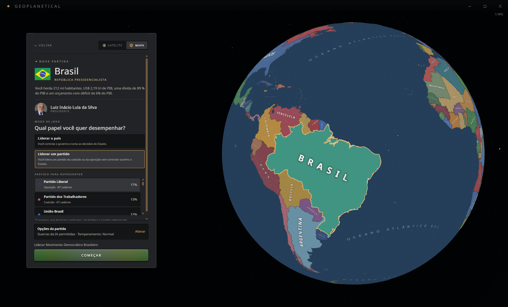
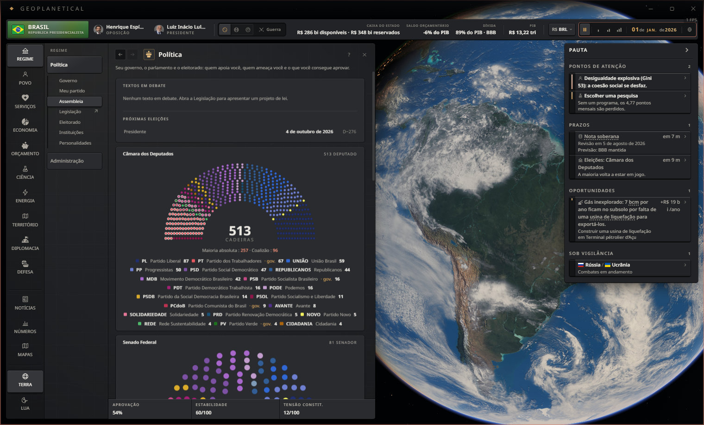
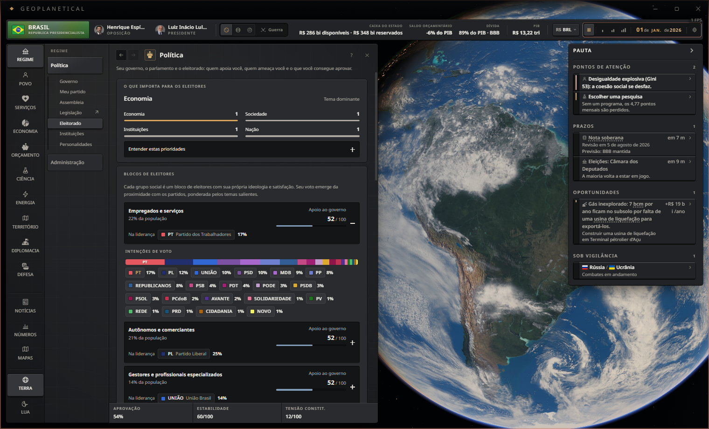

# Brasil Real 2026 | 0.6.0 experimental

[**Baixar o instalador único para Windows**](https://github.com/wsantosmarques/geoplanetical-brasil-real-2026/releases/download/v0.6.0-experimental/BrasilReal2026-Instalador-0.6.0.exe)

[Releases e versões anteriores](https://github.com/wsantosmarques/geoplanetical-brasil-real-2026/releases). A versão 0.5.1 era apenas mod + cenário e uma extensão visual; a 0.6.0 acrescenta campanhas novas com os 20 partidos.

## Instalação simples

Execute `BrasilReal2026-Instalador-0.6.0.exe`, confira a pasta detectada e clique em **Instalar / atualizar**. Não é necessário instalar Python ou executar comandos. Feche o Geoplanetical antes da instalação. A janela também oferece **Restaurar jogo**.

O instalador configura o mod de nomes e instala a integração 0.2.0. Requer Windows e os arquivos exatos das versões 1.0.6 e 1.0.7 estudadas do jogo; versões diferentes são recusadas. Reserve cerca de 12 GB para cópia temporária e backups. O instalador ainda não possui assinatura digital.

## O que muda

- **Novo jogo, Brasil:** o preset passa de quatro blocos agregados para 20 partidos. A opção Liderar um partido oferece os 20, incluindo PT; Liderar o país continua disponível.
- **Campanha nova:** a simulação nasce com os mesmos 20 IDs, ideologias, apoios e cores da escolha inicial. Câmara com 513 cadeiras; Senado com 81, incluindo uma cadeira independente.
- **Governo inicial:** núcleo configurado com PT, PCdoB, PV e PSB. É uma aproximação mínima, não uma reprodução de todos os apoios, federações e ministérios.
- **Eleitorado:** a distribuição exposta para cada grupo brasileiro mostra os 20 partidos, em vez de resumir apenas os três primeiros. Os cálculos já percorriam a lista completa de partidos. As larguras usam frações exatas; só os textos são arredondados.
- **Estúdio:** os 20 partidos permanecem disponíveis com indicadores de esquerda/direita.
- **Nomes:** mod de apresentação atualizado para 0.6.0, incluindo a apresentação do presidente como Luiz Inácio Lula da Silva. Retratos e muitos personagens auxiliares ainda são genéricos.

## Partidas existentes

**Uma campanha antiga com quatro partidos continua com quatro.** O instalador não abre, converte nem regrava saves. Para usar os 20, comece uma campanha nova depois de instalar, ou carregue o cenário complementar anteriormente distribuído. Uma campanha iniciada antes da integração não recebe os partidos retroativamente.

O mod de nomes pode alterar a apresentação de nomes em campanhas antigas enquanto estiver ativo, sem regravar o conteúdo do save.

## Backup e restauração

Os arquivos originais do jogo são guardados em `%LOCALAPPDATA%/BrasilRealEditor/backups`. Metadados e configuração anteriores do mod ficam em `mod-backups` na mesma área. O instalador mantém um recibo na pasta do jogo e verifica hashes antes de instalar ou restaurar.

**Restaurar jogo** recupera os arquivos do jogo e preserva os mods e saves. Atualizações da Steam ou verificação de arquivos podem remover a integração; ela só deve ser reinstalada depois de uma conferência de compatibilidade. Os fuses e a verificação de integridade do Electron continuam ativos.

Se ocorrer estado `recovery-required`, preserve a pasta temporária e o backup indicados no recibo. Uma gravação incompleta pode exigir recuperação manual. O instalador recusa substituir arquivos que tenham mudado por outra origem.

## Fidelidade

Apoio inicial é uma calibração baseada em cadeiras, não pesquisa de intenção de voto. Ideologias, atributos e cores incluem aproximações. O motor mantém simplificações eleitorais, ministeriais e legislativas; este pacote não implementa integralmente o sistema brasileiro nem prevê resultados reais. Os partidos não equivalem a um cadastro individual completo de deputados e senadores.

Fontes e histórico: https://github.com/wsantosmarques/geoplanetical-brasil-real-2026

Esta versão exige nova campanha para validar o comportamento completo. A publicação na Oficina Steam continua separada: assinar apenas o mod oficial não instala a integração.

## Fontes e imagens

As fontes históricas e aproximações estão em `fontes`. O mod oficial está em `oficina`; assinar apenas esse mod não instala os novos presets. A capa foi criada com IA para o projeto. Retratos reais de políticos ainda não foram adicionados. O código calcula o patch a partir da instalação local e não redistribui o executável ou o ASAR original do jogo.

## Validação

- Na 1.0.6: 20 partidos desde o bootstrap; controle de MDB e PT; 310 dias com eleições, recarga e totais de 513/81. Eleitorado com 20 partidos nos 17 grupos. Uma cópia de save antigo permaneceu com os quatro IDs originais.
- Revisão final da coalizão: núcleo de PT, PCdoB, PV e PSB, avanço de 31 dias e recarga.
- Na 1.0.7: bootstrap, controle de MDB e PT, coalizão, 31 dias e recarga.
- Instalador único: execução do runtime embutido com Tk e arquivos de 20 partidos, sem depender de Python instalado.

Esses testes não equivalem a validar todas as regras do processo político brasileiro.

## Capturas da integração na 1.0.7

Capturas do aplicativo desktop em cópia isolada, com mod local. A campanha foi iniciada pelo Novo jogo, escolhendo MDB. Nenhuma campanha do usuário foi usada nas imagens.

Conferência nativa: 20 opções de escolha, Assembleia com 513/81, 20 partidos nos 17 grupos do eleitorado e nenhum erro de execução.
