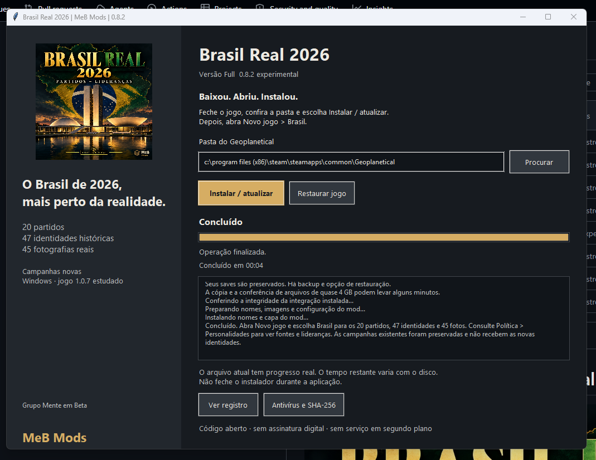
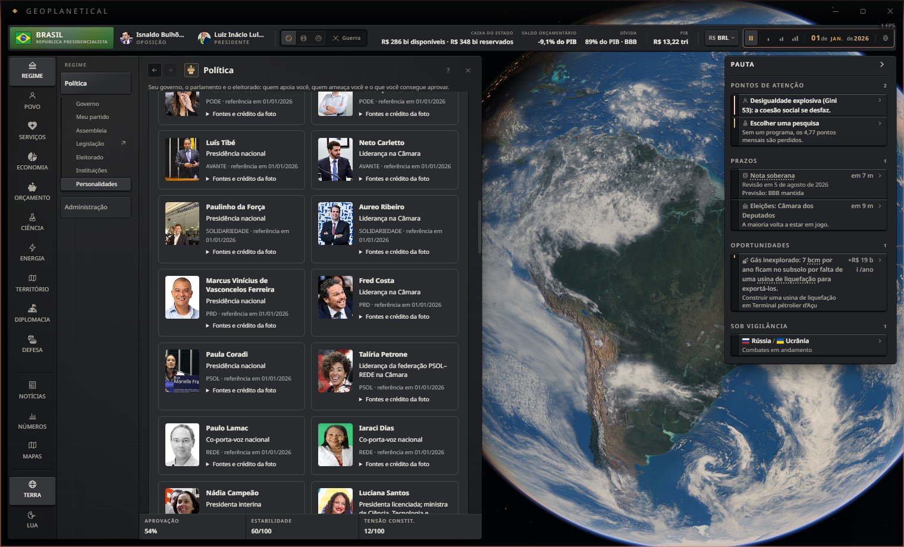

# Brasil Real 2026 · MeB Mods

 

**Brasil em 1º de janeiro de 2026:** 20 partidos, 47 identidades históricas e 45 fotografias reais em campanhas novas. Primeira release pública **0.8.2**, integração **0.3.1** para Windows / Geoplanetical **1.0.7 estudado**.

[**Baixar instalador único (.exe)**](https://github.com/wsantosmarques/geoplanetical-brasil-real-2026/releases/download/v0.8.2/BrasilReal2026-Instalador-0.8.2.exe) · [Releases e SHA-256](https://github.com/wsantosmarques/geoplanetical-brasil-real-2026/releases) · [Verificações antivírus](seguranca/README.md)

## Qual versão escolher?

| | Steam, somente Oficina | Full, instalador do GitHub |
|---|---|---|
| Instalação | Assinar, ativar e reiniciar | Baixar **BrasilReal2026-Instalador-0.8.2.exe**, fechar o jogo e instalar |
| Nomes/siglas e nome/foto de Lula | Sim, nos alvos existentes | Sim |
| 20 partidos na escolha inicial, Congresso, estúdio e eleitorado | Não | Sim, em campanha nova |
| 47 identidades e 45 fotos | Não | Sim |
| Ministérios adicionais funcionais | Não | Ainda não implementados |

**Instalar a Full é simples:** baixe o EXE no GitHub, feche o jogo e clique em **Instalar / atualizar**. Dispensa Python e gerenciador instalado no Windows.

**Antivírus 0.8.2:** Defender local e [GitHub Actions passaram](https://github.com/wsantosmarques/geoplanetical-brasil-real-2026/actions/runs/41378808053), sem ameaça detectada. [Relatórios e hashes](seguranca/README.md).

**Antivírus e integridade:** [resultados por versão, relatórios Defender e hashes SHA-256](seguranca/README.md). O EXE não tem assinatura digital: Edge/SmartScreen pode avisar sobre reputação insuficiente e fornecedor desconhecido. As análises não são certificação ou garantia absoluta.

## Veja no jogo

Capturas em perfil de teste separado. Clique para ampliar; as imagens ficam reunidas aqui.

| Partidos na escolha inicial | Presidências nacionais e Câmara |
|---|---|
|  |  |
| **Ministros nas telas nativas** | **Intenções de voto** |
|  |  |
| **Instalador Full 0.8.2: teste concluído** | **Três novas fotografias** |
|  |  |

A captura do instalador mostra a **atualização real da 0.8.2 concluída pelo usuário**, sobre a integração 0.3.1. Conferimos os hashes dos arquivos instalados e **nove saves permaneceram iguais**. Os dados políticos continuam os da 0.8.0. [Registro do teste](docs/teste-manual-0.8.2.json).

[Ajuda para instalar e entender os avisos do Windows](docs/instalacao.md).

## Instalação e uso

1. Feche o jogo, execute o EXE e clique em **Instalar / atualizar**.
2. Abra **Novo jogo → Brasil** para receber os novos dados.
3. Veja **Política → Personalidades** para consultar as lideranças, fontes e créditos.

Dispensa Python. Faz backup e oferece **Restaurar jogo**. Reserve cerca de 12 GB para cópias temporárias/backups. Arquivos de outras versões do jogo são recusados. O instalador ainda não tem assinatura digital.

**As partidas existentes não são convertidas.** Campanhas anteriores, inclusive da 0.7, conservam seus personagens. As novas fotos de pessoas já identificadas podem aparecer ao carregar saves dessa integração, pois acompanham a chave da pessoa; isso não acrescenta pessoas ou pastas ao save. O cenário antigo também não recebe as identidades por instalação.

## O que esta versão entrega

- 20 partidos no Novo jogo, no estúdio, na simulação e nos 17 grupos do eleitorado. Câmara com 513 cadeiras; Senado com 81, incluindo uma cadeira independente.
- Presidências nacionais e líderes na Câmara separados. REDE tem dois co-porta-vozes; PCdoB distingue Nádia Campeão em exercício e Luciana Santos licenciada.
- Federações usam referências compartilhadas, sem clonar pessoas ou alterar sua filiação.
- Presidente Lula, vice Alckmin e quatro titulares nas pastas compatíveis do motor: Haddad, José Múcio, Mauro Vieira e Lewandowski.
- **45 fotografias**, incluindo as novas de Paula Coradi (Câmara), Iaraci Dias e Marcus Vinícius Ferreira (TSE 2022), com créditos e licenças.

## O que ainda falta

**Fotos de Antonio Rueda e Eduardo Ribeiro:** não foi confirmada fonte reutilizável adequada. Eles continuam com nome e aviso “Foto pendente”. [Pesquisa e pedido de autorização preparado](docs/fotos-pendentes.md).

**Ministérios reais adicionais:** ainda não são cargos funcionais no motor. Interior continua fictício. Pesquisamos os **38 postos ministeriais** do corte histórico, distinguindo 32 pastas/órgãos e seis postos com status de ministro. [Inventário e investigação técnica](docs/ministerios.md). O próximo protótipo recomendado é Educação, com nomeação, reforma, conselho, efeito setorial e persistência completos, em cópia isolada.

Apoio inicial deriva de calibração de cadeiras, não de pesquisa eleitoral. Ideologias, cores e atributos incluem aproximações. O quadro documenta 01/01/2026; acontecimentos posteriores seguem a simulação. Demais personagens podem continuar genéricos. Parentes fictícios herdados são desvinculados na inicialização; eventos familiares futuros são simulação.

## Publicação na Steam

O conteúdo está preparado para o usuário publicar pelo **Estúdio de mods**. O link da página da Oficina será acrescentado após o envio ser aceito pela Steam. [Instruções de publicação](oficina/PUBLICACAO-0.8.2.md).

A Oficina fornece a apresentação; o **instalador Full do GitHub** acrescenta os partidos e as identidades às campanhas novas, conforme a comparação acima.

## Fontes, créditos e documentação

[Cadastro das pessoas](fontes/identidades/pessoas-2026.json) · [Créditos das fotografias](fontes/identidades/CREDITOS.md) · [Ministérios](docs/ministerios.md) · [MeB Mods](docs/marca.md) · [Guia oficial de mods](docs/wiki-oficial.md) · [Pendências](CHECKLIST.md) · [Versões](VERSOES.md)

Fotografias mantêm suas licenças e autoria; a presença não indica apoio ao projeto. A capa é arte criada com IA. O código calcula o patch a partir da instalação local e não redistribui o executável ou o ASAR original do jogo.

Backups, restauração e validação

Originais em `%LOCALAPPDATA%/BrasilRealEditor/backups`; arquivos anteriores do mod/configuração em `mod-backups`. Restaurar recupera o jogo preservando mods e saves. Atualizações da Steam podem remover o patch e exigem nova conferência de compatibilidade. Fuses e integridade do Electron permanecem ativos.

Na 0.7: duas sementes, 47 identidades, salvar/recarregar e um dia; desktop com 20 opções, 47 registros e 42 fotos; 44/44 referências partidárias preservadas. Uma cópia de save antigo manteve quatro partidos e zero identidades novas. Na 0.6, os testes de 310 dias/eleições e 31 dias precedem as identidades atuais; não são prova de longo prazo da 0.8.

A 0.8 passou no teste desktop isolado com 45 fotos. Na 0.8.2, 16 casos de registro inválido foram recusados antes de preparar o mod; testes de instalação/restauração e rollback passaram em temporários. A atualização do EXE real foi concluída pelo usuário, e os arquivos instalados e nove saves foram conferidos. Instalação limpa e restauração completa pelo EXE ainda não tiveram teste manual nesta rodada. [Validação da 0.8.2](docs/validacao-instalador-0.8.2.json).

Não foi implementado um gabinete de 38 cargos funcionais.

**Atualizações futuras:** estudamos um botão de consulta às releases, sem serviço residente. Ainda não está implementado. [Opções e recomendação](docs/atualizacoes-futuras.md).

**0.8.1 substituída:** o teste real no clone encontrou falso sucesso quando o registro de instalação estava incompleto. Use a 0.8.2. [O que foi corrigido e validado](docs/validacao-instalador-0.8.2.json). [Assinatura digital: opções e pendências](docs/assinatura-digital.md).
