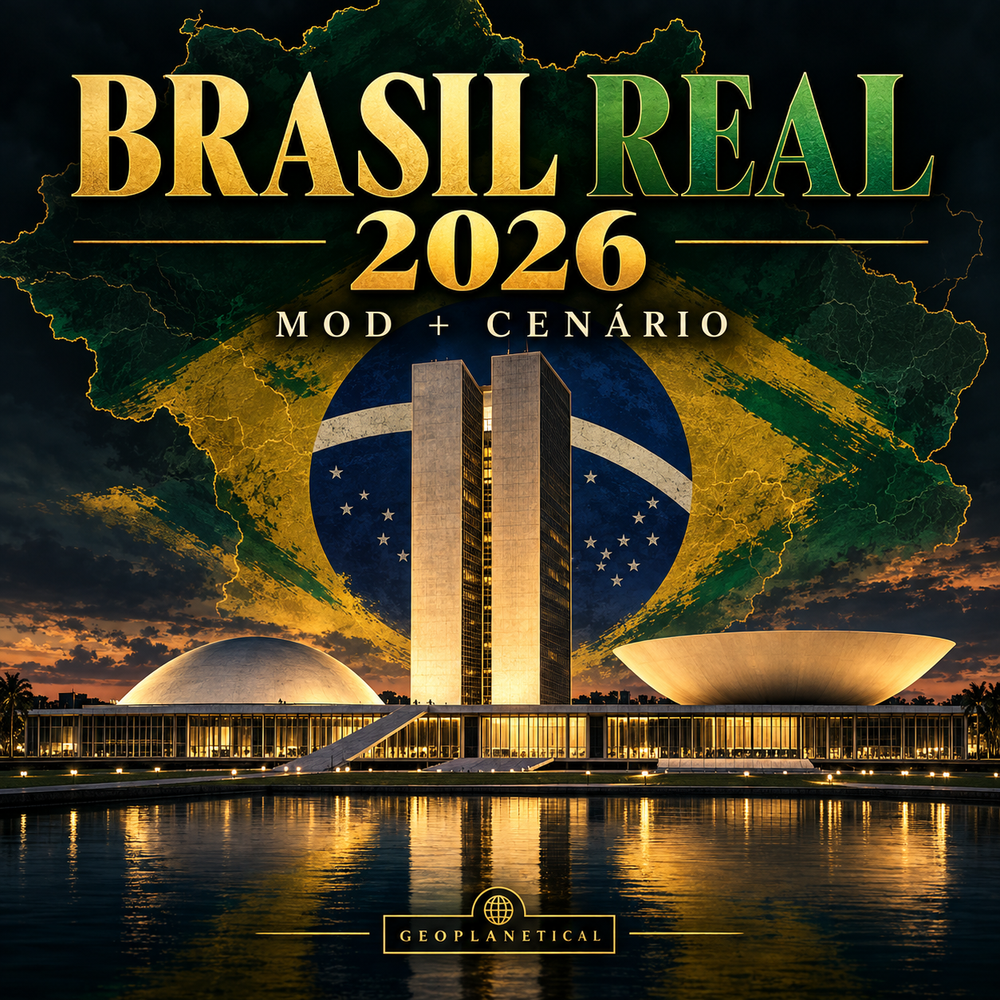
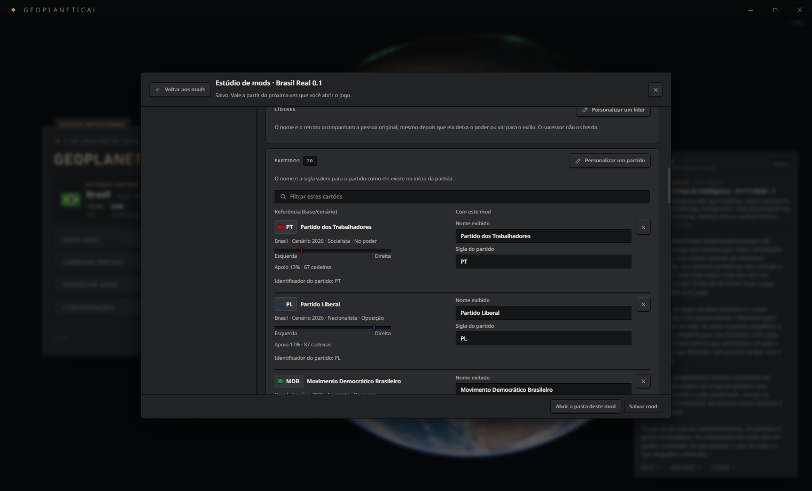
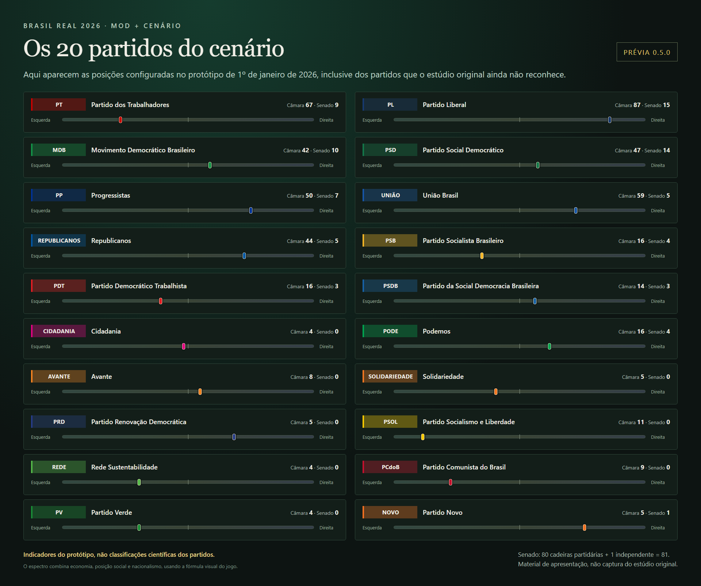

# Brasil Real 2026

Prévia experimental do Brasil no início de 2026 para Geoplanetical. Mod **0.5.1** e extensão visual opcional **0.1.0**.



## Escolha seu pacote

Baixe os ZIPs em [Releases](https://github.com/wsantosmarques/geoplanetical-brasil-real-2026/releases).

| Pacote | Conteúdo | Estúdio |
|---|---|---|
| Padrão | Mod de nomes e cenário complementar | Os partidos exclusivos do cenário podem aparecer como alvo desconhecido |
| Com extensão | Mesmo conteúdo e instalador visual separado | 20 partidos com indicadores esquerda/direita |

**Ativar o mod e clicar em Novo jogo não cria os 20 partidos.** Para essa estrutura, instale o cenário complementar e use **Carregar partida > Brasil_Real_2026_Experimental**. A extensão também não muda a criação de campanhas novas.

## Instalar o mod e o cenário

1. Extraia o ZIP em uma pasta temporária. Guarde uma cópia da sua campanha.
2. Se você ainda não utiliza o item da Oficina, copie a pasta `mod-local-opcional/brasil-real-2026` para `%APPDATA%/Geoplanetical/mods`. Se já utiliza o item da Oficina, não instale uma segunda cópia local com o mesmo identificador.
3. Copie `cenario/Brasil_Real_2026_Experimental.gsav` para `%APPDATA%/Geoplanetical/saves`. **Não sobrescreva uma partida existente:** se houver arquivo com o mesmo nome, preserve-o e escolha outro nome para a cópia importada.
4. Habilite o mod em Gerenciar mods e reinicie o jogo. Carregue o cenário pelo menu Carregar partida. Grave seu teste com outro nome.

O mod fornece nomes e siglas; o save fornece a estrutura política. Ao voltar a uma campanha antiga, desative o mod e reinicie se quiser manter seus nomes anteriores.

## Instalar a extensão opcional

Somente para **Windows e os arquivos exatos do Geoplanetical 1.0.6 estudados**. Não funciona em qualquer versão que tenha o mesmo número caso o conteúdo dos arquivos seja diferente. Requer **Python 3.11 ou superior**, espaço livre para cópia e backup completos do pacote do jogo (reserve cerca de 12 GB) e permissão para escrever na pasta da instalação. Não usa bibliotecas Python externas.

Feche o jogo. No pacote Com extensão, abra um terminal na pasta `extensao-editor` e execute:

```powershell
python instalar_extensao.py instalar
```

Se o jogo estiver em outra biblioteca Steam, indique o caminho:

```powershell
python instalar_extensao.py instalar --jogo "D:/SteamLibrary/steamapps/common/Geoplanetical"
```

O instalador mantém um backup completo em `%LOCALAPPDATA%/BrasilRealEditor/backups` e um recibo na pasta do jogo. O backup não deve ser apagado enquanto a extensão estiver instalada. Os fuses e a verificação de integridade permanecem habilitados; o hash do pacote modificado é atualizado no executável local. O motor da simulação e os saves não são editados.

Reabra o jogo e abra o mod no estúdio. A identificação **Brasil Real 0.1** aparece na interface em português, com os 20 indicadores. A lista tem paginação: use Mostrar mais para ver os restantes. As barrinhas são somente de leitura; mudar ideologia continua exigindo uma nova versão do cenário.

Para restaurar os arquivos originais, feche o jogo e execute:

```powershell
python instalar_extensao.py restaurar
```

Use o mesmo `--jogo` se necessário. O restaurador recusa sobrescrever arquivos que tenham mudado por atualização da Steam ou outra origem. Atualizações/verificação pela Steam podem remover a extensão; não force a instalação em uma versão diferente.

Se o recibo registrar `recovery-required`, preserve o backup e o staging indicado e procure assistência. A restauração automática pode recusar um arquivo parcialmente gravado que não corresponda a nenhum hash conhecido.

## Conteúdo e limites

- 20 partidos com nomes reais e parâmetros de jogo próprios.
- Câmara com 513 cadeiras: reconstrução do DCD de 23/12/2025 e atualização de 29/12. O intervalo até 01/01 não foi auditado individualmente por completo.
- Senado com 80 cadeiras vinculadas aos partidos e 1 independente, a partir de exercícios e filiações na data de referência.
- Parte dos dirigentes e integrantes do governo tem nomes reais. Presidentes partidários são aproximados ao papel do motor e não equivalem necessariamente a líderes de bancada ou candidatos presidenciais.
- Apoio inicial deriva da proporção de cadeiras. Não representa pesquisa de opinião. Ideologias, cores e atributos são calibrações editoriais, não avaliações científicas ou factuais de pessoas.
- Retratos e personagens auxiliares continuam genéricos. Não há cadastro individual completo de 513 deputados e 81 senadores.
- A coalizão do protótipo é um núcleo mínimo; não representa todos os apoios parlamentares, federações ou ministérios.
- O motor mantém simplificações: posse no dia eleitoral, renovação do Senado sem alternância automática entre 2/3 e 1/3 e processo legislativo não convertido integralmente para o brasileiro.
- O pacote não atualiza todo o restante do mundo nem prevê eleições reais.

Fontes e campos aproximados: arquivos em `fontes`. O cenário preserva o conteúdo político da versão experimental 0.4.

## Imagens e testes



Captura do aplicativo desktop com extensão 0.1.0, em cópia isolada do jogo 1.0.6. Teste do editor: 20 indicadores, nenhum alvo desconhecido, capa carregada, inicialização concluída e nenhum erro de execução. O cenário também foi carregado no aplicativo desktop em perfil separado. Esses ensaios não substituem testes completos de jogabilidade na versão atual.



A imagem acima é um material editorial criado para a prévia 0.5.0, não uma captura do jogo. A capa foi criada com IA para este projeto. Nenhum retrato fotográfico real de político foi acrescentado nesta versão.

As ferramentas deste repositório calculam o patch a partir da instalação local. O repositório não inclui o executável ou o pacote ASAR do jogo. O cenário é distribuído como partida complementar nos ZIPs da release. Projeto independente de Wander, sem vínculo com o desenvolvedor do jogo.
