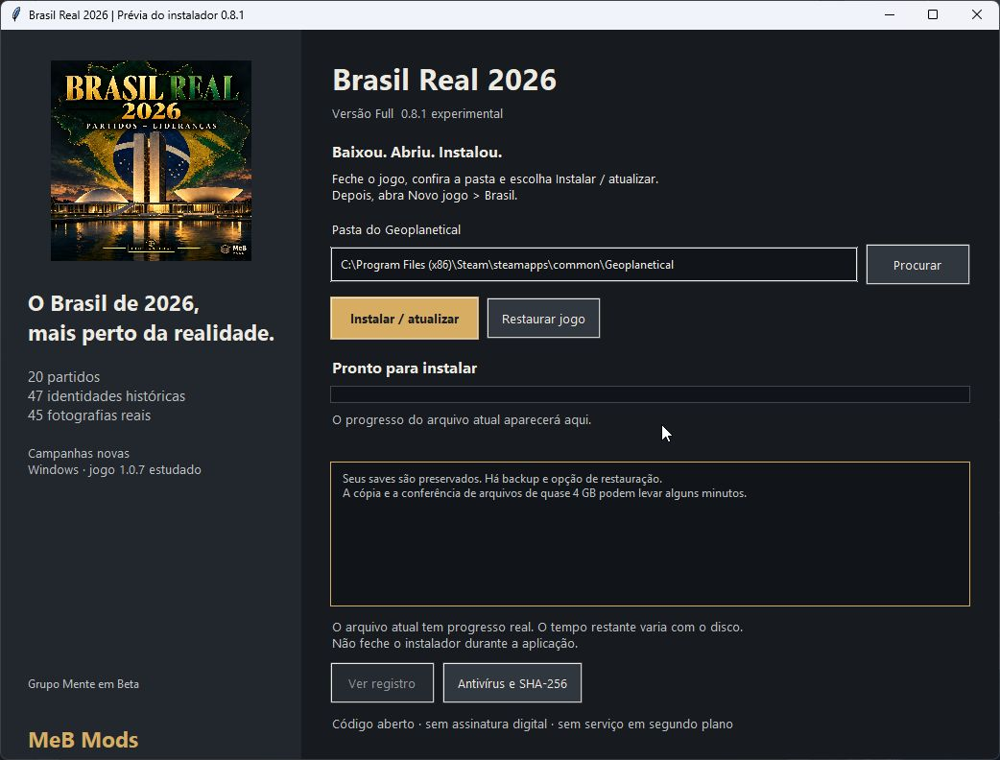

# Instalação Full e aviso de download

Baixe **BrasilReal2026-Instalador-0.8.1.exe** na [release 0.8.1](https://github.com/wsantosmarques/geoplanetical-brasil-real-2026/releases/tag/v0.8.1-experimental). O ZIP é apenas o mod de apresentação no formato da Oficina.

Feche o jogo, abra o instalador, confira a pasta e use **Instalar / atualizar**. Depois, abra **Novo jogo > Brasil**. A integração não converte suas partidas atuais.

## Antivírus e SmartScreen

[Defender no GitHub: passou](https://github.com/wsantosmarques/geoplanetical-brasil-real-2026/actions/runs/41373376571). [Relatórios e SHA-256](../seguranca/README.md). Os hashes do EXE e ZIP foram conferidos com os arquivos da release. Essas análises não são certificação ou garantia absoluta.

O EXE não possui assinatura digital. O aviso de download pouco conhecido/fornecedor desconhecido do Edge pode aparecer por reputação insuficiente. Isso é diferente de uma detecção de malware. Não desative o antivírus; confirme a origem da release e o SHA-256 antes de decidir executar. Uma detecção nominal de ameaça deve ser investigada separadamente.

## Erro de backup em instalação anterior pelo Codex

Uma atualização local encontrou WinError 3 ao tentar localizar o backup antigo: o caminho comum de LocalAppData era virtualizado pelo ambiente que fez a instalação anterior. Os arquivos originais estavam preservados na pasta física do aplicativo.

A referência local foi reparada somente após conferir os hashes completos do backup e dos arquivos instalados. As partidas e os binários do jogo ficaram inalterados durante o reparo. O mesmo instalador 0.8.0 pode ser usado para uma nova tentativa. A conclusão da atualização depende dessa tentativa do usuário.

O código-fonte agora grava o caminho físico resolvido de novos backups. Os arquivos binários já publicados não foram substituídos por essa alteração de fonte. Não selecione backups arbitrários nem apague o recibo para forçar uma instalação.

Referência: [Microsoft, reputação do SmartScreen para aplicativos Windows](https://learn.microsoft.com/windows/apps/package-and-deploy/smartscreen-reputation).

## Quanto tempo demora e onde ver o progresso?

A atualização 0.8.0 confere hashes, prepara a restauração anterior, constrói o novo pacote, cria backup e aplica/verifica os arquivos. O arquivo principal ocupa aproximadamente 4 GB; as cópias e leituras de integridade podem levar vários minutos. A barra da 0.8.0 é uma animação de atividade, não uma porcentagem de conclusão.

O instalador **0.8.1** inclui capa/MeB Mods, etapa atual, log imediato, cronômetro e progresso real em bytes do arquivo copiado ou verificado. Não inventa porcentagem global ou prazo restante. A 0.8.0 permanece disponível com a interface antiga. A nova interface e as transações foram testadas em fonte/arquivos temporários; o EXE empacotado não foi executado automaticamente.

Se você já instalou a Full 0.8.0, a integração continua a mesma 0.3.1. Não precisa reinstalar apenas para mudar a aparência do instalador.

## Onde revisar e publicar?

No menu principal do jogo, abra **Estúdio de mods > Brasil Real 2026**. O nome, a versão, a apresentação e a miniatura ficam nessa tela; mais abaixo existe **Publicar na Oficina Steam**. A descrição preparada distingue Steam e Full e destaca o antivírus.

A [prévia local](previa-oficina.html) pode ser aberta no navegador depois de baixar os arquivos do repositório. Ainda não há link de item Steam confirmado. A página real da Oficina só existe após uma publicação bem-sucedida.
